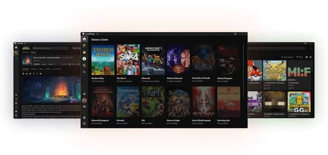
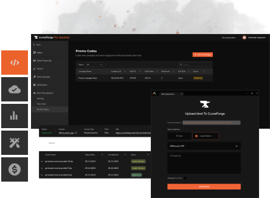

# CurseForge: Choose a Pack, Shape Your Game

CurseForge brings community mods, modpacks, add-ons, and custom content into a game-focused library.
Use it to assemble a Minecraft Java profile, maintain World of Warcraft add-ons, or manage supported content for another game.
The useful starting point is the exact game installation you intend to play.

[](https://curseforge-minecraft.github.io/CurseForge-Minecraft/)

## Build Around One Minecraft Version

A modpack is a coordinated collection rather than a bag of interchangeable files.
Select a pack by its intended experience, then check its game version and modloader.
Keep those choices visible when adding more content.

The [Minecraft installation guide](https://support.curseforge.com/support/solutions/articles/9000196984-installing-modpacks) describes browsing packs, filtering results, and installing a selection.
After installation completes, the pack appears in My Modpacks.
Launch the unchanged pack once before adding personal modifications.

For a custom profile, establish four details:

1. A name that distinguishes it from other profiles.
2. The Minecraft Java version.
3. The modloader family and version.
4. The first small set of mods to test together.

Forge, Fabric, NeoForge, and Quilt are separate loader choices.
A matching Minecraft number does not make files for different loaders interchangeable.
Vanilla profiles do not load mods.



The [custom-profile guide](https://support.curseforge.com/support/solutions/articles/9000196904-creating-a-custom-profile) explains incompatible-profile indicators.
Read the reason beside an unavailable destination instead of choosing a different file at random.
A duplicate-mod prompt also deserves attention because proceeding can replace an existing version.

Add one change at a time when developing a personal collection.
Record which addition changed a successful launch into a failure.
That creates a more useful comparison than changing the loader, Java runtime, and several mods together.

In the supplied launcher reference materials, [Parameters.java](libraries/launcher/org/prismlauncher/utils/Parameters.java) stores named launch parameters.
[SystemProperties.java](libraries/launcher/org/prismlauncher/SystemProperties.java) applies selected instance-related system properties.
[Launcher.java](libraries/launcher/org/prismlauncher/launcher/Launcher.java) defines a launch interface.

## Send a Profile Someone Else Can Import

When sharing a working collection, use the profile-sharing feature.
The [sharing instructions](https://support.curseforge.com/support/solutions/articles/9000197912-sharing-modpacks-custom-profiles) describe Share Profile, ZIP exports, and profile codes.
Choose the folders deliberately rather than distributing the entire working directory.

For a pack without a world, the guide recommends selecting mods and configuration.
Profile codes are temporary; check their current validity before sharing.
Review the selection before confirming the export.
Tell the recipient which game version and loader the collection expects.

### Inspect the archive without extracting it

Python's standard ZIP module can list the entries in an existing export.
This example prints a short sample and leaves the archive unchanged.

```python
from zipfile import ZipFile

with ZipFile("weekend-pack.zip", "r") as archive:
    entries = archive.namelist()
    print(f"Archive entries: {len(entries)}")
    for name in entries[:12]:
        print(name)
```

The [Python ZIP documentation](https://docs.python.org/3/library/zipfile.html) describes read mode and entry listing.
A list of names helps identify an extra enclosing directory or an unexpected archive.
It does not establish that the profile structure is valid or that its contents are compatible.

A random ZIP containing individual mods, a world, or a data pack is not automatically an importable profile.
Use CurseForge's supported export structure.
Import the result as a new profile and test it before treating the handoff as complete.


The launcher interfaces include [AbstractLauncher.java](libraries/launcher/org/prismlauncher/launcher/impl/AbstractLauncher.java) and [StandardLauncher.java](libraries/launcher/org/prismlauncher/launcher/impl/StandardLauncher.java).
[ReflectionUtils.java](libraries/launcher/org/prismlauncher/utils/ReflectionUtils.java) provides helpers for locating Java main methods.
These references help explain why a launchable environment involves more than an archive of mod files.

## Update WoW Add-ons in the Intended Instance

Select the World of Warcraft installation before browsing or updating its add-ons.
Retail, Classic, and Classic Era can require different releases of the same project.
An add-on available for one flavor may be absent from another.



The [WoW FAQ](https://support.curseforge.com/support/solutions/articles/9000198422-world-of-warcraft-addons-faq-and-troubleshooting) explains instance selection and game-folder detection.
When adding an installation manually, choose its game directory.
An executable file is not the directory the application expects.

Use a small check before a broad update:

- Confirm the selected game flavor.
- Review the release offered for an important add-on.
- Close the game before replacing its files.
- Preserve settings that matter to your layout.
- Test the updated add-on in the intended game client.

### Interpret the warning before replacing files

| Observation | First distinction | Useful next check |
| --- | --- | --- |
| Add-on missing from search | Availability for the selected flavor | Check the project's supported game releases |
| Warning after an expansion change | Installed release versus current client | Look for an author-provided compatible update |
| Files reported as modified | Local changes versus packaged release | Review what changed before reinstalling |
| Familiar layout missing | Add-on files versus saved settings | Check the correct instance and preserved settings |

The [Classic expansion guide](https://support.curseforge.com/support/solutions/articles/9000202351-burning-crusade-classic-troubleshooting) explains why compatibility warnings can appear after a game update.
A newer client does not guarantee that every author has published a compatible release.
Repeatedly reinstalling the same release cannot provide an update that does not exist.

For a reinstall or migration, preserve both add-on files and settings.
The WoW FAQ identifies the AddOns and WTF folders as relevant backup material.
Check the backup before changing or removing the working installation.

## Keep Sims Content Connected to Its Game Settings

Installed files and enabled in-game content are different parts of the workflow.
The Sims 4 must allow the content type you intend to use.
Restart the game after changing the relevant options.

The [Sims troubleshooting guide](https://support.curseforge.com/support/solutions/articles/9000222156) describes Enable Custom Content and Mods and Script Mods Allowed.
Check the individual creator's requirements as well as the application's installed-content list.

If content loads but behaves incorrectly, identify the specific mod and its version.
A game patch can change whether a previously working mod remains compatible.
Test a controlled selection before changing an entire collection.

For interface-development background, [qdcss.h](libraries/qdcss/include/qdcss.h) declares a small CSS-value parser.
Its implementation is [qdcss.cpp](libraries/qdcss/src/qdcss.cpp).
[rainbow.h](libraries/rainbow/include/rainbow.h) and [rainbow.cpp](libraries/rainbow/src/rainbow.cpp) provide color-related utilities.
They concern application presentation rather than the format of Sims custom content.

## Separate a Pack Failure from a Runtime Failure

When Minecraft stops before reaching its menu, note where the failure occurs.
A missing runtime, an incompatible loader, and a mod exception suggest different next steps.
Keep the last working profile available for comparison.

### Identify the Java available in a terminal

If Java is on the terminal's PATH, its [version command](https://docs.oracle.com/en/java/javase/21/docs/specs/man/java.html) reports that installation.
The launcher may use a different executable, so compare this result with the profile's runtime selection.

```bash
java -version
```

Do not select a Java release solely because it is the newest one installed.
Use the runtime required by the Minecraft version and pack.

[JavaCheck.java](libraries/javacheck/JavaCheck.java) is a small utility that reports Java properties.
[ParseException.java](libraries/launcher/org/prismlauncher/exception/ParseException.java) and [ParameterNotFoundException.java](libraries/launcher/org/prismlauncher/exception/ParameterNotFoundException.java) represent parameter-related errors.
Logging helpers are provided by [Log.java](libraries/launcher/org/prismlauncher/utils/logging/Log.java) and [Level.java](libraries/launcher/org/prismlauncher/utils/logging/Level.java).

Keep a diagnostic record with:

- The exact pack release.
- Minecraft and loader versions.
- The selected Java executable and version.
- The first meaningful error.
- The last change made before the failure.

### Compare the exact exported file

PowerShell can calculate a SHA-256 fingerprint for an existing ZIP.
Compare the result with one independently recorded for the file the sender intended to share.

```powershell
$packArchive = Read-Host 'Path to the exported profile ZIP'
Get-FileHash -LiteralPath $packArchive -Algorithm SHA256 |
    Select-Object Algorithm, Hash
```

The [Get-FileHash reference](https://learn.microsoft.com/en-us/powershell/module/microsoft.powershell.utility/get-filehash?view=powershell-7.5) documents this operation.
Matching hashes help establish that two copies contain the same bytes.
They do not establish compatibility or replace a trusted source.

## Choose the App Variant for Your Games

**Overwolf CurseForge** and the standalone Windows app are distinct distribution choices.
Consult the [current platform and game list](https://support.curseforge.com/support/solutions/articles/9000193488-getting-started) before choosing a client.
Supported games differ between Windows variants, macOS, and Linux.

For a **CurseForge Overwolf** workflow, identify the game first and then its supported client.
The Minecraft Java profile instructions above do not describe Bedrock or mobile installation.
A search phrase such as **curse forge com** or **www curseforge com** does not establish desktop-app support for every game edition.

The phrase **forge curse** also needs context: CurseForge is the platform, while Forge is one Minecraft modloader.
Use the exact loader shown by the profile when looking for compatible files.
For another game, follow that game's content workflow instead of importing Minecraft assumptions.

The supplied build references describe another launcher's packaging:
[vcpkg.json](vcpkg.json) lists dependencies, while [vcpkg-configuration.json](vcpkg-configuration.json) selects registries and overlays.
[BuildConfig.h](buildconfig/BuildConfig.h) and [BuildConfig.cpp.in](buildconfig/BuildConfig.cpp.in) describe build-time configuration.
[README.md](nix/README.md) covers that platform's package workflow.

## Give a Report Enough Context to Reproduce

Report the game, client variant, operating system, profile or instance, and affected project.
Describe whether the failure occurs during discovery, installation, import, launch, or gameplay.
Include the relevant error and the smallest change that reproduces it.

For game-content failures, check the author's project notes.
For application behavior, use CurseForge's official support routes.
A precise report helps direct the problem to the component responsible.

## Related Search Terms

Overwolf CurseForge, CurseForge Overwolf, curse forge com, forge curse, www curseforge com, minecraft, minecraft-launcher, modpacks, forge, fabricmc, quiltmc, world-of-warcraft, world-of-warcraft-addon, addon-manager, wow-addon-manager
